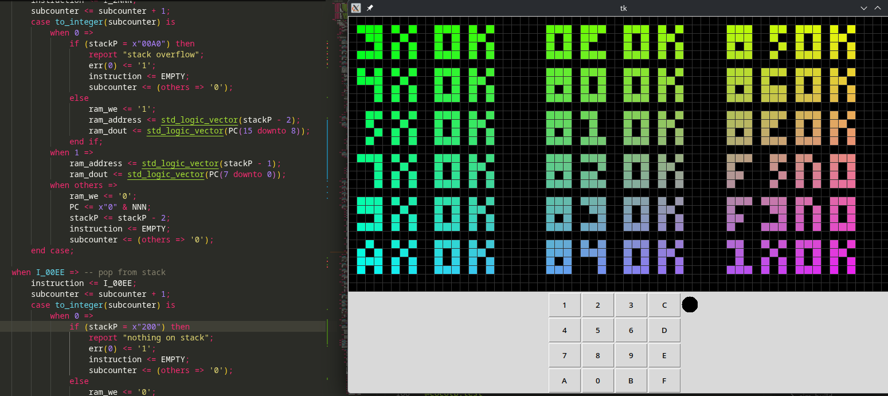
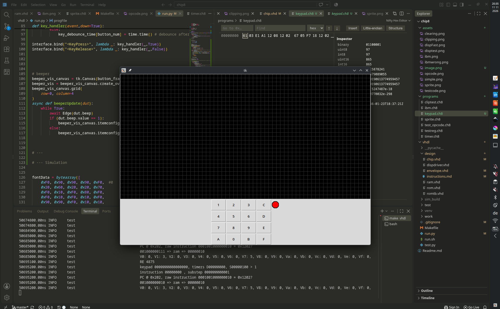

# Chip-8 implementation using VHDL

## Summary

This is a project made for hackclub [chipper](https://chipper.hackclub.com/), designing a chip-8 interpreter in VHDL. Since this is my very first time using a HDL, this is not really aimed to be an actual FPGA-ready design ( although i am trying to make it synthesizable ).

The interface portion of the language is implemented using cocotb in python. This handles loading the program data into a RAM component and letting the user interact with the simulated circuit with a gui.

Things I've used a lot in making this:

- [Instruction reference](https://tobiasvl.github.io/blog/write-a-chip-8-emulator/) as reference.
- [German vhdl intro](https://www.uni-ulm.de/fileadmin/website_uni_ulm/iui.inst.050/vorlesungen/sose08/LaborpraktikumEingebetteteSysteme/Material/Crashkurs_)
- [this repo](https://github.com/Timendus/chip8-test-suite/tree/main) with test programs (next to self-written ones)
- No AI was used for writing any of the code/documentation.

## Component ports

These are the connections which the Simulated chip uses to interact with external components:

- `clock` and `chipEN`
- `ram_address`, `ram_din`/`ram_dout` and `ram_we`
    - read/writing single bytes from a synchronous RAM, using a 12 bit address (4096 locations)
- `display_dout`, `display_clk`
    - 16 bit signal consisting of 8 pixel values and an 8 bit position value
    - clock signal that is synced to the main clock when writing to display.
- `beep`
    - output signal to the buzzer
- `keypad`
    - 16 bit signal with 1 bit per key `0`-`F`
- also implements an error signal `err`, used for debugging if an undefined instruction or a stack overflow occurs

## Status Logs

### Working stack

The instructions `2NNN` and `00EE` ( subroutine at `NNN` and return) are now implemented!

The stack runs from memory address `0200` (not inclusive) down to `00A0`, allowing for a maximum call depth of 176. The memory area `0050` to `009F` is reserved for font data.

### The Keypad and instructions `EX9E`/`EXA1`/`FX0A`

Added a keypad to the interface ( also accessible through the keyboard using keys 1-4,q-r,a-f and y-v ), and wrote programs to test the skip and wait functionality respectively.
Also added a beeper output ( visual only cause beeps are annoying )

`keypad.ch8` will activate the beep for 5s ( circle turns red ) when key 3 is pressed.

`keywait.ch8` will draw a square on the screen as long as a key is pressed, storing the number in V7.

### Timers

Added support for the timer instructions ( load from/to VX) and the buzzer output ( still missing in gui though)
1Hz signal is generated by using a clock division counter. This has to match the `realClockHz` in the interface, which sets how fast the clock pulse is given in real time. The simulation has a seperate clock Frequency used for stepping the simulation time, which is mostly irrelevant.

There also is a third clock, hooked up to the display driver running at ~10GHz simulation time.
With this, display instructions dont experience the visible screen tearing from the long display update time (5s at 50Hz real clock, 0.26s at the actual 1kHz clock in the simulation)

### Arithmetic instructions & others

Described (see `design/instructions.mb`) all and implemented multiple remaining instructions. This includes the arithmetic instructions `8...` and some conditional jumps.
Still missing instructions are:

- `E...` reading key press
- `F...`
    - waiting for key
    - timers ( still have to be implemented in hardware)
    - font addressing
    - BCD
    - memory store/load
- `CNNN` random value, possible seperate module implementation
- `2NNN`/`00EE` stack operations

Result of opcode test program:

### Implemented DXYN

The Drawing instruction now works!
Simple sprite test ( sprite 3C7E7E3C at 2,2):

With this, the current instructions suffice to run the IBM test program:

Its displayed in the wrong position due to some incorrect calculation of the offset, but the logo itself is visible.
Corrected version:

### Updated and seperate display driver

This version now implements a 2048 bit display buffer, and a seperate clocked display driver which refreshes 8 pixels per clock cycle. Screen clearing is now a lot faster and doesnt block other instructions.

Test display clear also writes the bytes 0xAABBCCDD in the middle of the display, to test the buffer working properly.

### Implemented instructions 1NNN, 6XNN and 7XNN

debug of a simple program consisting of these 3 instructions ( see top left ) setting V4 to E0 and counting up by 1:

### Running 00E0

Running a program consisting of just the single instruction `00E0`, clearing the screen ( takes 2047 clock cycles)

### Parsing opcodes from RAM

Reading the two byte opcode `00E0` into a register over 4 clock cycles

### Working test interface

Interface harness can load and dump the connected RAM, aswell as recieve a rudimentary display signal from the simulation. Currently the chip just outputs a test signal, writing white pixels into diagonal lines.

( Image after 610 clock cycles, pixels are displayed in color just to look fancy :p )

